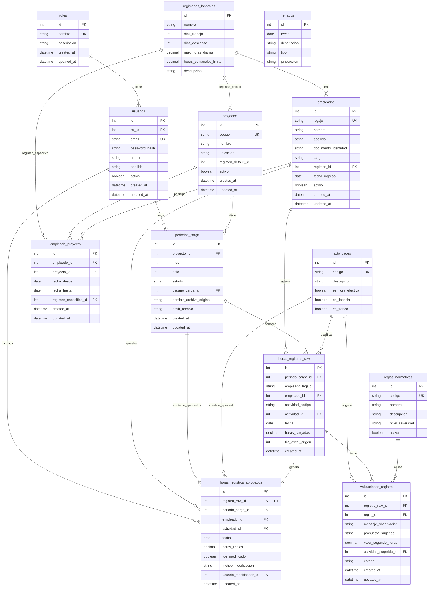

# 🗄️ Diagrama Entidad-Relación - Gestor de Nómina

## Diagrama ER Completo



## 📊 Descripción de Relaciones

### 1. Módulo de Seguridad
- **roles → usuarios** (1:N): Un rol puede tener múltiples usuarios
- Los roles definen permisos del sistema (Admin, Supervisor, Operador, Consulta)

### 2. Módulo de Configuración Laboral
- **regimenes_laborales → proyectos** (1:N): Un régimen puede ser default de varios proyectos
- **regimenes_laborales → empleados** (1:N): Un régimen puede aplicarse a varios empleados
- **regimenes_laborales → empleado_proyecto** (1:N): Régimen específico por asignación

### 3. Módulo de Empleados y Proyectos
- **proyectos ↔ empleados** (N:M via empleado_proyecto): Relación muchos a muchos
- **empleado_proyecto**: Tabla intermedia con fechas de vigencia y régimen específico

### 4. Módulo de Períodos de Carga
- **proyectos → periodos_carga** (1:N): Un proyecto tiene múltiples períodos de carga
- **usuarios → periodos_carga** (1:N): Un usuario puede cargar múltiples períodos
- Control de archivos Excel importados con hash para duplicados

### 5. Módulo de Registro de Horas (RAW)
- **periodos_carga → horas_registros_raw** (1:N): Un período contiene múltiples registros
- **empleados → horas_registros_raw** (1:N): Un empleado tiene múltiples registros
- **actividades → horas_registros_raw** (1:N): Una actividad clasifica múltiples registros
- Datos en formato vertical sin modificaciones (staging)

### 6. Módulo de Validación
- **reglas_normativas → validaciones_registro** (1:N): Una regla genera múltiples validaciones
- **horas_registros_raw → validaciones_registro** (1:N): Un registro puede tener múltiples observaciones
- **actividades → validaciones_registro** (1:N): Actividades sugeridas para corrección

### 7. Módulo de Aprobación (APPROVED)
- **horas_registros_raw → horas_registros_aprobados** (1:1): Relación uno a uno obligatoria
- **usuarios → horas_registros_aprobados** (1:N): Usuario que realizó la modificación
- Trazabilidad completa del cambio

### 8. Catálogos y Referencias
- **feriados**: Tabla independiente de calendario
- **actividades**: Catálogo de códigos de actividades/horas

## 🔑 Claves e Índices

### Claves Únicas (UK)
- `roles.nombre`
- `usuarios.email`
- `proyectos.codigo`
- `empleados.legajo`
- `actividades.codigo`
- `reglas_normativas.codigo`

### Índices Compuestos
```sql
-- Para búsquedas por período
CREATE INDEX idx_periodos_proyecto_fecha 
ON periodos_carga(proyecto_id, mes, anio);

-- Para búsquedas de feriados
CREATE INDEX idx_feriados_fecha_jurisdiccion 
ON feriados(fecha, jurisdiccion);

-- Para búsquedas de registros raw
CREATE INDEX idx_horas_raw_periodo_empleado 
ON horas_registros_raw(periodo_carga_id, empleado_id, fecha);

-- Para búsquedas de registros aprobados
CREATE INDEX idx_horas_aprobados_periodo_empleado 
ON horas_registros_aprobados(periodo_carga_id, empleado_id, fecha);
```

## 🔄 Flujo de Datos

```
┌─────────────────────────────────────────────────────┐
│                   EXCEL IMPORT                       │
│            (Matriz horizontal: Días 1-31)            │
└──────────────────────┬──────────────────────────────┘
                       │
                       ▼
┌─────────────────────────────────────────────────────┐
│              PERIODOS_CARGA                          │
│   (Control: mes, año, archivo, hash, estado)         │
└──────────────────────┬──────────────────────────────┘
                       │
                       ▼
┌─────────────────────────────────────────────────────┐
│           HORAS_REGISTROS_RAW                        │
│  (Staging: datos sin modificar, formato vertical)    │
│         empleado_legajo + actividad_codigo           │
└──────────────────────┬──────────────────────────────┘
                       │
                       ▼
┌─────────────────────────────────────────────────────┐
│              MOTOR DE VALIDACIÓN                     │
│  (Aplica REGLAS_NORMATIVAS sobre RAW)                │
└──────────────────────┬──────────────────────────────┘
                       │
                       ▼
┌─────────────────────────────────────────────────────┐
│          VALIDACIONES_REGISTRO                       │
│  (Observaciones, propuestas, valores sugeridos)      │
└──────────────────────┬──────────────────────────────┘
                       │
                       ▼
┌─────────────────────────────────────────────────────┐
│          UI DE CORRECCIÓN (Supervisor)               │
│    (Vista dual: RAW vs Sugerido, edición manual)    │
└──────────────────────┬──────────────────────────────┘
                       │
                       ▼
┌─────────────────────────────────────────────────────┐
│        HORAS_REGISTROS_APROBADOS                     │
│  (Datos finales: relación 1:1 con RAW, trazabilidad)│
│      fue_modificado + motivo_modificacion            │
└──────────────────────┬──────────────────────────────┘
                       │
                       ▼
┌─────────────────────────────────────────────────────┐
│              EXCEL EXPORT                            │
│     (Regeneración: formato matricial horizontal)     │
└─────────────────────────────────────────────────────┘
```

## 📈 Cardinalidades Importantes

| Relación | Cardinalidad | Tipo | OnDelete |
|----------|-------------|------|----------|
| Rol → Usuario | 1:N | Obligatoria | Restrict |
| RegimenLaboral → Proyecto | 1:N | Opcional | SetNull |
| RegimenLaboral → Empleado | 1:N | Opcional | SetNull |
| Proyecto ↔ Empleado | N:M | Via EmpleadoProyecto | - |
| PeriodoCarga → HoraRegistroRaw | 1:N | Obligatoria | Cascade |
| HoraRegistroRaw → HoraRegistroAprobado | 1:1 | Obligatoria | Cascade |
| HoraRegistroRaw → ValidacionRegistro | 1:N | Opcional | Cascade |
| ReglaNormativa → ValidacionRegistro | 1:N | Obligatoria | Restrict |
| Usuario → PeriodoCarga | 1:N | Opcional | SetNull |
| Usuario → HoraRegistroAprobado | 1:N | Opcional | SetNull |

## 🎯 Puntos Clave del Diseño

### 1. Trazabilidad Completa
- Relación 1:1 entre RAW y APROBADO mantiene historial completo
- Campo `fue_modificado` identifica cambios
- Campo `motivo_modificacion` documenta razones
- `usuario_modificador_id` registra quién hizo el cambio

### 2. Formato Dual
- **RAW**: Almacena códigos originales (empleado_legajo, actividad_codigo)
- **APROBADO**: Usa IDs resueltos (empleado_id, actividad_id)
- Permite detectar empleados/actividades no encontrados

### 3. Validación en Capas
- **Staging**: Datos crudos sin validar
- **Validación**: Motor con reglas configurables
- **Aprobación**: Revisión humana con sugerencias automáticas

### 4. Flexibilidad de Regímenes
- Régimen por defecto en Proyecto
- Régimen general por Empleado
- Régimen específico por asignación Empleado-Proyecto
- Prioridad: Específico > Empleado > Proyecto

### 5. Auditoría Temporal
- `created_at` / `updated_at` en entidades principales
- `fecha_desde` / `fecha_hasta` en asignaciones
- Control de períodos por mes/año

## 📝 Notas de Implementación

1. **PostgreSQL**: Todas las fechas usan `timestamp with time zone`
2. **Decimales**: Precisión (5,2) para horas (máx 999.99)
3. **Nomenclatura**: snake_case en BD, PascalCase en C#
4. **Cascadas**: Configuradas para mantener integridad referencial
5. **Índices**: Optimizados para consultas frecuentes por período y empleado

---

**Versión del Modelo**: 1.0 - PASO 1 Completado
**Última actualización**: Octubre 2026
